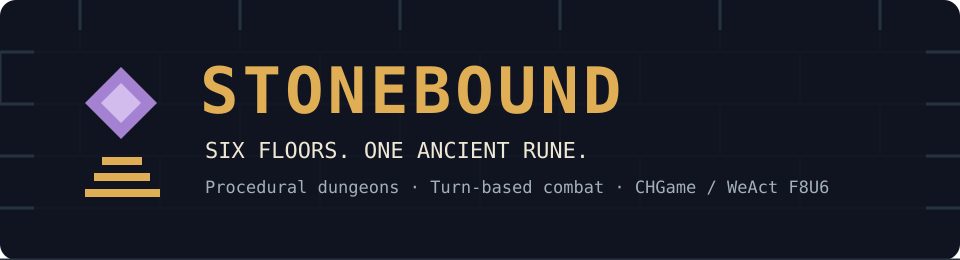

# Stonebound

**Six floors. One ancient rune. A turn-based dungeon roguelike for CHGame.**

The town's protective ward has failed. Below its streets, the Underhollow
keeps the last binding rune behind six floors of forgotten stone.
Choose a Delver or an Arcanist, manage your supplies, and defeat the Stone
Warden to bring the light back.

Stonebound is an original, compact adaptation of classic dungeon-crawler
mechanics, inspired by [Dungeon Crawl Stone Soup](https://crawl.develz.org/).
Its code and artwork were written for the CH32X035 memory limits. It is not
the full DCSS engine and does not require a DCSS installation or data files.

## Play

**[Install on your WeAct console](INSTALL.md)** ·
**[Build and test](DEVELOPING.md)** ·
**[Get the verified download](https://github.com/veluv01/CHGame/actions/workflows/stonebound.yml)**

The workflow's **Stonebound-WeAct-0.1.0** artifact contains the ready-to-copy
**GAMES/STONE.CHG**, raw firmware, source, screenshots and measured memory report.
Artifacts expire after 30 days; the workflow can reproduce the package.

## What is included

- Six connected, procedurally generated 24x24 dungeon floors.
- Two heroes: the sturdy Delver and the mana-rich Arcanist.
- Bump-to-attack combat, experience, levels, weapon and armour upgrades.
- Cave rats, ash bats, bone guards, ranged wraiths and a final Stone Warden.
- Spark Bolt, Mending Light and Stone Nova; enemies act after successful actions.
- Fog of war, doors, hidden traps, gold, healing potions, mana tonics and food.
- Story introduction, boss health bar, pause, defeat and victory screens.
- Complete current-floor saves, including moving enemies and explored terrain.
- Five-second START hold to save and return to the SD menu.
- Release and debug PlatformIO profiles for the existing WeAct F8U6 variant.

## Controls

| Button | Action |
|---|---|
| D-pad | Move; attack an adjacent enemy; open a closed door |
| A | Wait one turn; descend while standing on stairs |
| B | Open the spellbook |
| SELECT | Open the satchel; on the title, change hero for a new journey |
| START, tap and release | Pause or resume |
| START, hold five seconds | Save and return to the console menu |
| Menu UP / DOWN | Select an option |
| Menu A / B | Confirm / back |

Opening a menu, attempting to walk into a wall, or casting without a valid
target does not spend a turn. Moving, attacking, opening a door, consuming
a useful item or successfully casting a spell gives nearby enemies a turn.
Mana slowly returns as turns pass. Eat rations before food runs out.

Delvers begin with more health and defence. Arcanists begin with more mana
and stronger Spark Bolts. Face a target before casting a bolt; stone walls
and closed doors stop it. Nova affects nearby enemies and briefly stuns them.
Collect equipment to automatically equip an upgrade; spare gear becomes gold.

Each floor's stairs lead onward. On the last floor, the Warden must be
defeated before the exit yields the binding rune.

## Hardware and resources

The project uses the existing **WeAct CH32X035F8U6 / WF86** variant and pin map.
No rewiring or added hardware is needed. The TFT runs at 12 MHz SPI with
12-bit panel output; the interface targets 30 updates per second.
The game remains turn-based, so decisions have no time limit.

Art is embedded as small original pixel glyphs. The card installs the game;
the game does not perform asset streaming. The application reserves both
flash save pages. Its complete game state must fit the library's 244-byte
save record, enforced at compile time.

Read **BUILD_REPORT.md** in the produced package for the measured release
and debug image sizes. Firmware size, static RAM, package CRC and board
identity are checked before the package is created. Physical hardware was
not connected during software validation.

## Project layout

| File | Purpose |
|---|---|
| Game.h / Game.cpp | Portable rules, generation, compact state and save reconstruction |
| View.h / View.cpp | Original pixel art and 128x128 screens |
| Stonebound.ino | CHGame input, pacing, saves and console integration |
| platformio.ini | WeAct release and debug builds using the shared core |
| tools/tests/test_game.cpp | Generation, rules, saves, limits and randomized action tests |
| tools/sim_check.py | Real sketch input, save, quit and screenshot checks |
| tools/package.py | Board-checked CHG download, memory report and source ZIP |

## Development and licensing

[DEVELOPING.md](DEVELOPING.md) describes the generator, save format and
validation commands. The project follows CHGame's public APIs and has no
changes to the Arduino core, graphics library, board pins or bootloader.

Stonebound's original code and art use the MIT licence: [LICENSE](LICENSE).
The surrounding CHGame framework and DCSS retain their own licences and
credits.
